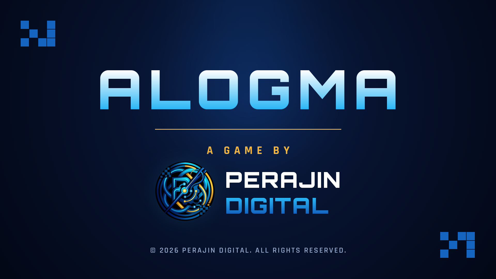
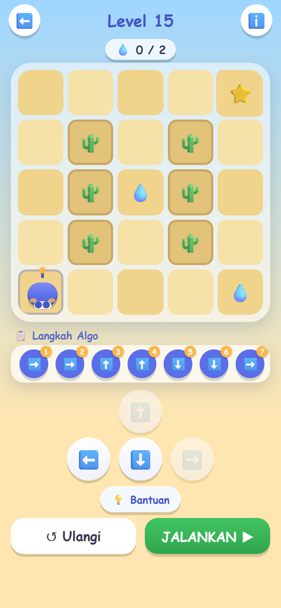
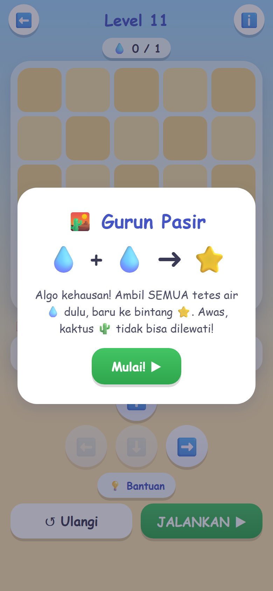
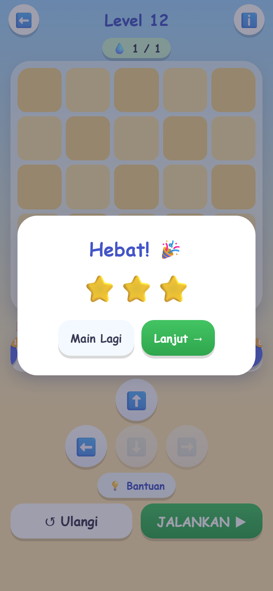
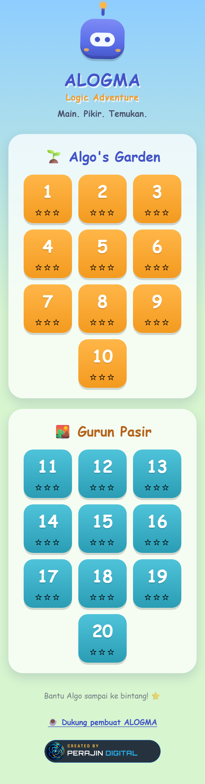

  

# ALOGMA Logic Adventure

**Main. Pikir. Temukan.** A browser logic puzzle game that introduces children to planning, sequencing and problem solving, which are the first steps of computational thinking.

### ▶ [Play now: alogma-logic-adventure.vercel.app](https://alogma-logic-adventure.vercel.app)

Free, no sign-up, works on phones and desktops. The in-game language is Indonesian.

  
  
  

## How it works

Players help **Algo**, a friendly robot, reach the star ⭐. They plan the whole route first by queuing arrow commands, then press **JALANKAN ▶** and watch Algo follow the plan step by step. If Algo bumps into something or stops short, the player looks at what went wrong, adjusts the plan and tries again.

## Worlds

| World | Levels | What players learn |
|---|---|---|
| 🌱 **Algo's Garden** | 1–10 | Sequencing: plan a route around rocks on a 4×4 grid |
| 🏜️ **Gurun Pasir** | 11–20 | Planning with goals: collect every water drop 💧 before reaching the star, on a 5×5 grid with cacti |

## Features

- 20 hand-designed levels with a gradual difficulty curve. Every level has been checked by a solver, so each one can be finished and three stars always match the shortest route.
- ⭐ to ⭐⭐⭐ ratings that reward efficient solutions.
- A hint button on every level that nudges with a question and never gives the answer.
- A short intro card when a new world begins.
- Progress is saved in the browser, with no account needed.
- Designed for small hands: big buttons, and arrows are disabled when they would walk Algo off the board.

Home screen

## Built with

HTML, CSS and vanilla JavaScript, with no frameworks and no backend. Deployed on Vercel.

The game's source code is kept in a private repository. This repository is a showcase only.

## Support

If ALOGMA helps your child learn, you can support its development on **[Saweria](https://saweria.co/perajinDigital)** ☕

---

Created by **Perajin Digital**. © 2026, all rights reserved.
